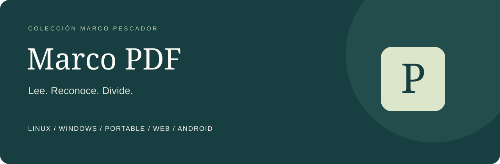

<p align="center"></p>

<p align="center">
<a href="LICENSE"></a>
<a href="https://github.com/Peskysa/marco-pdf/actions/workflows/release.yml"></a>
<a href="https://github.com/Peskysa/marco-pdf/releases/latest"></a>
</p>

<p align="center"><strong>Tus documentos, en orden.</strong><br>Lee PDF, convierte escaneos en texto buscable y divide archivos por páginas o megas.<br>Español · English · Français. Procesamiento en tu dispositivo.</p>

<p align="center"><a href="https://marco-pdf.peskysa.chatgpt.site"><strong>ABRIR MARCO PDF WEB</strong></a> · <a href="https://github.com/Peskysa/marco-pdf/releases/latest">Descargas</a> · <a href="docs/README.md">Documentación</a> · <a href="https://github.com/Peskysa/marco-pdf/issues/new/choose">Ayuda y sugerencias</a></p>

---

## Un espacio para tus PDF

Abre un documento, recorre sus páginas, ajusta el zoom y busca texto. Utiliza los rangos de la barra lateral para elegir qué páginas quieres procesar. El archivo original se conserva.


## Elige dónde usarlo

| Versión | Qué descargar / abrir | Internet para usarla |
| --- | --- | --- |
| **Portable** · Windows x64 | [Marco-PDF-Portable.exe](https://github.com/Peskysa/marco-pdf/releases/download/v1.2.0/Marco-PDF-Portable.exe) | No |
| **Portable web** · Windows x64 | [Marco-PDF-Web-Portable.exe](https://github.com/Peskysa/marco-pdf/releases/download/v1.2.0/Marco-PDF-Web-Portable.exe) | No: abre la aplicación en tu navegador local |
| **Web normal** | [Abrir web normal](https://marco-pdf.peskysa.chatgpt.site) · [ZIP para alojar](https://github.com/Peskysa/marco-pdf/releases/download/v1.2.0/Marco-PDF-Web.zip) | Sí para la web alojada |
| **Instalador Windows** · x64 | [Marco-PDF-Windows-Instalador.exe](https://github.com/Peskysa/marco-pdf/releases/download/v1.2.0/Marco-PDF-Windows-Instalador.exe) | No tras descargarlo |
| **Instalador Linux** · amd64 | [Marco-PDF-Linux-amd64.deb](https://github.com/Peskysa/marco-pdf/releases/download/v1.2.0/Marco-PDF-Linux-amd64.deb) | No para el procesamiento |
| **Android** | [Marco-PDF-Android.apk](https://github.com/Peskysa/marco-pdf/releases/download/v1.2.0/Marco-PDF-Android.apk) | No tras descargarlo |

**Las seis versiones incluyen interfaz y OCR en español, inglés y francés.** El idioma de la interfaz se elige arriba; el idioma del documento, en el apartado OCR. Puedes reconocer uno de los tres idiomas o los tres juntos.

**No necesitas instalar Python, Node.js ni Tesseract para utilizar las aplicaciones compiladas.** El portable y el portable web son ejecutables únicos: cópialos a una carpeta o USB y ábrelos. El portable web incluye todos los recursos y crea un servidor de solo lectura en `127.0.0.1`; no se conecta a un servidor de Internet. Mantén abierta su ventana mientras utilizas el navegador.

El instalador Windows funciona para el usuario actual, sin permisos de administrador. El DEB Linux se instala con el gestor de paquetes y requiere un entorno compatible con Ubuntu 22.04/glibc 2.35. El APK necesita WebView actualizado y no se ha probado en un teléfono físico. La web alojada es pública y el repositorio de GitHub mantiene acceso privado. [Instalación de las seis versiones](docs/INSTALACION.md).

## Lo que puedes hacer

| Leer y encontrar | Preparar y compartir |
| --- | --- |
| Navegar por páginas y ajustar el zoom | Extraer rangos como `1-3,5,8-10` |
| Buscar texto y ver una versión copiable | Crear un archivo cada N páginas |
| Abrir PDF con contraseña en escritorio | Dividir por tamaño máximo real en MB |
| OCR en español, inglés, francés o los tres | Descargar las partes en ZIP en web/Android |

### Divide sin perder páginas

Selecciona un número de páginas o un límite de megas. Marco PDF comprueba el tamaño del PDF resultante antes de aceptarlo. Si una página individual supera el límite, muestra un aviso para aumentarlo; no corta una página por la mitad ni reduce su calidad para forzar el tamaño.


### Haz que tus escaneos tengan texto

Selecciona el idioma y crea otro PDF con una capa de texto buscable. Abre el resultado para buscar y copiar su contenido. El OCR trabaja sobre las páginas que no tienen texto; las que ya lo tienen se conservan.

<table><tr><td width="74%"></td><td width="26%"></td></tr><tr><td align="center">De imagen a texto buscable.</td><td align="center">También en pequeño.</td></tr></table>

Capturas de la aplicación web real con contenido ficticio sin datos personales. La vista móvil simula un ancho de 390 píxeles; no es una captura de un teléfono Android físico. [Cómo reproducir las capturas](docs/CAPTURAS.md).

## Idiomas


La interfaz y el OCR son ajustes independientes: por ejemplo, puedes usar la interfaz en español para reconocer un documento francés.

## Empieza en tres pasos

1. Pulsa **Abrir PDF** o arrastra un documento a la web.
2. Deja el campo de páginas vacío para usar todas, o escribe un rango como `2-5,8`.
3. Elige **Dividir PDF** o **Crear PDF con OCR** y guarda el resultado.

En escritorio se elige una carpeta para las partes y un nombre para el resultado OCR. En web aparecen botones de descarga; en Android se abre el menú del sistema para guardar o compartir. [Manual con ejemplos](docs/MANUAL.md).

## Documentación

- [Instalación y requisitos](docs/INSTALACION.md): Windows, Linux, portable, web y Android.
- [Manual](docs/MANUAL.md): lectura, OCR, rangos y división por páginas o megas.
- [Preguntas frecuentes](docs/PREGUNTAS.md): tamaño, PDF protegidos y problemas habituales.
- [Privacidad](docs/PRIVACIDAD.md): procesamiento y archivos guardados.
- [Desarrollo y compilación](docs/DESARROLLO.md): arquitectura, pruebas y paquetes.
- [Galería y capturas](docs/CAPTURAS.md), [historial](CHANGELOG.md) y [versión 1.2](docs/releases/v1.2.0.md).
- [Contribuir](CONTRIBUTING.md), [seguridad](SECURITY.md) y [terceros](THIRD_PARTY.md).
- [Licencia explicada](docs/LICENCIA.md) y [texto íntegro de AGPL-3.0](LICENSE).

## Alcance y limitaciones

El OCR no es perfecto: depende de la resolución, la orientación y la calidad del escaneo. Revisa el texto antes de utilizarlo. Las páginas mixtas que ya contienen texto no reciben OCR adicional en sus imágenes. La versión web usa una capa de texto latino; sustituye por `?` los caracteres que su fuente no puede representar.

Los documentos derivados no conservan las firmas digitales ni los marcadores originales. No es un editor de contenido, un compresor ni una herramienta de firma. Los archivos grandes pueden consumir bastante memoria. Los PDF con contraseña se abren únicamente en escritorio. [Diferencias entre plataformas](docs/MANUAL.md).

## Para desarrollar

Escritorio usa Python 3.12, PyMuPDF, Pillow y Tkinter. Web y Android comparten PDF.js, pdf-lib y Tesseract.js; Android utiliza Capacitor.

```sh
cd web
pnpm install --frozen-lockfile
pnpm test
pnpm build
pnpm dev
```

Se necesitan Node.js 24 y pnpm 11.25.0. Las compilaciones de GitHub ejecutan pruebas de división por páginas y bytes, OCR real y un recorrido del navegador. [Instrucciones completas](docs/DESARROLLO.md).

## Licencia y autoría

Creado por **Marco Pescador**. Código e identidad visual originales bajo [GNU AGPL versión 3](LICENSE). Puedes usar, estudiar, modificar y redistribuir el programa cumpliendo esa licencia. Los componentes de terceros conservan sus licencias.

Se mantiene AGPL-3.0 porque el motor de escritorio PyMuPDF se utiliza bajo su opción AGPL. [Licencia y fuentes oficiales](docs/LICENCIA.md).
