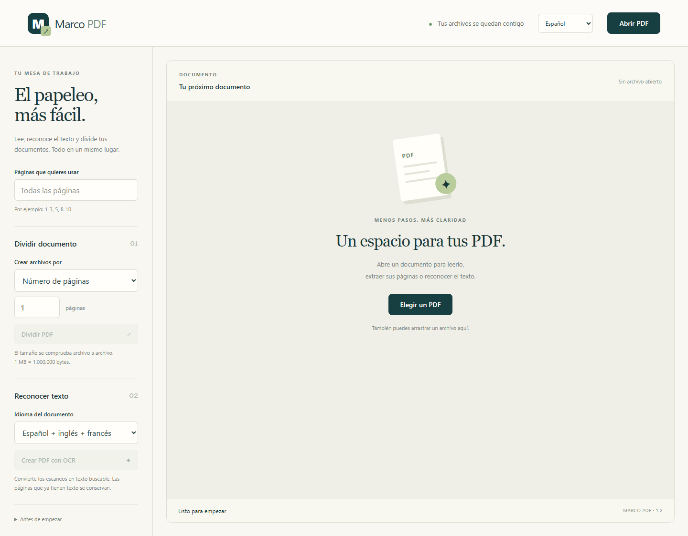
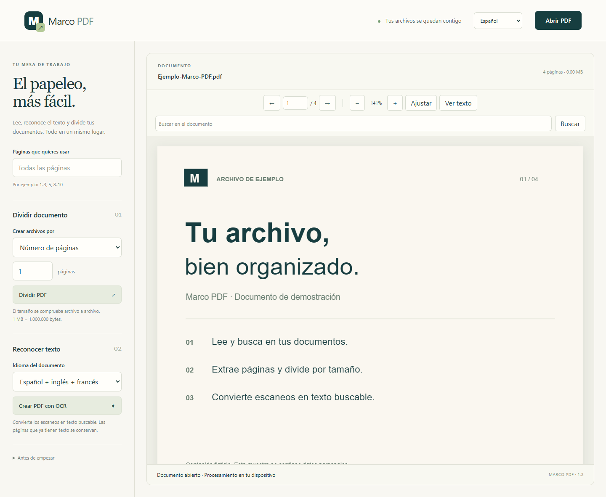
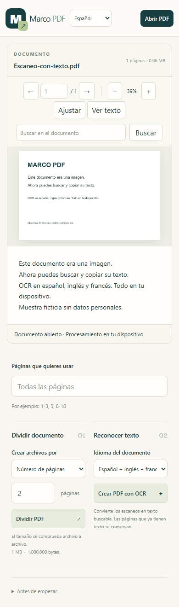
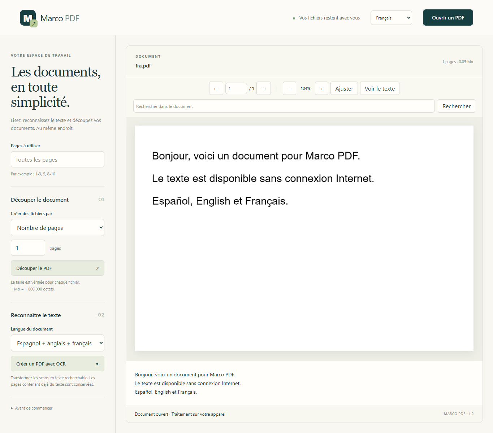

# Capturas reales

[Índice](README.md)

Todas estas imágenes proceden de la aplicación web ejecutándose en un navegador. Los documentos se generan con contenido ficticio sin datos personales. No son imágenes generadas por IA ni pantallas de funciones inexistentes.

## Inicio



## Lectura



## División por páginas

Un PDF ficticio de cuatro páginas se divide en dos archivos de dos páginas. La captura muestra los botones de descarga reales.


## OCR

Se crea una imagen con texto, se introduce como página escaneada, se procesa con OCR y se vuelve a abrir el PDF resultante. El panel inferior muestra el texto reconocido de verdad.


## Pantalla pequeña



Es una ventana de navegador de **390 × 844 píxeles**, capturada con toda su página. No es una fotografía de un dispositivo ni acredita una prueba en un móvil Android físico. Estas capturas tampoco representan la interfaz Tkinter de Windows/Linux, que utiliza otros controles.

## Interfaz francesa



Esta captura se genera con `web/tests/offline.mjs`, bloqueando todas las peticiones fuera de localhost. Las seis variantes de la versión 1.2 comparten los idiomas español, inglés y francés para interfaz y OCR.

## Reproducirlas

Con las dependencias instaladas y el servidor web activo en `http://127.0.0.1:5173/`, desde `web/`:

```sh
pnpm exec playwright install chromium
BROWSER_CHANNEL=chromium pnpm run screenshots
```

En PowerShell establece `$env:BROWSER_CHANNEL='chromium'` antes de ejecutar `pnpm run screenshots`. Puedes utilizar `msedge` si está instalado. `APP_URL` permite seleccionar otra dirección.

El script `web/scripts/screenshots.mjs` genera los ejemplos temporales en `test-output/screenshots/`, verifica el texto OCR y guarda las cinco imágenes de la galería básica en `docs/images/`. El banner de portada es una ilustración SVG original del proyecto, separada de las capturas.
