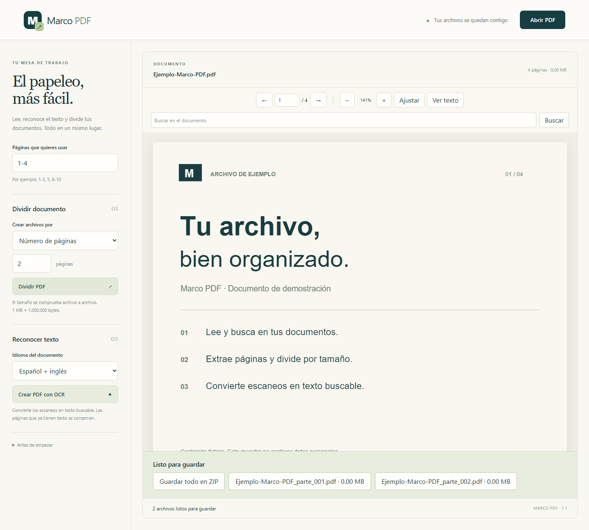
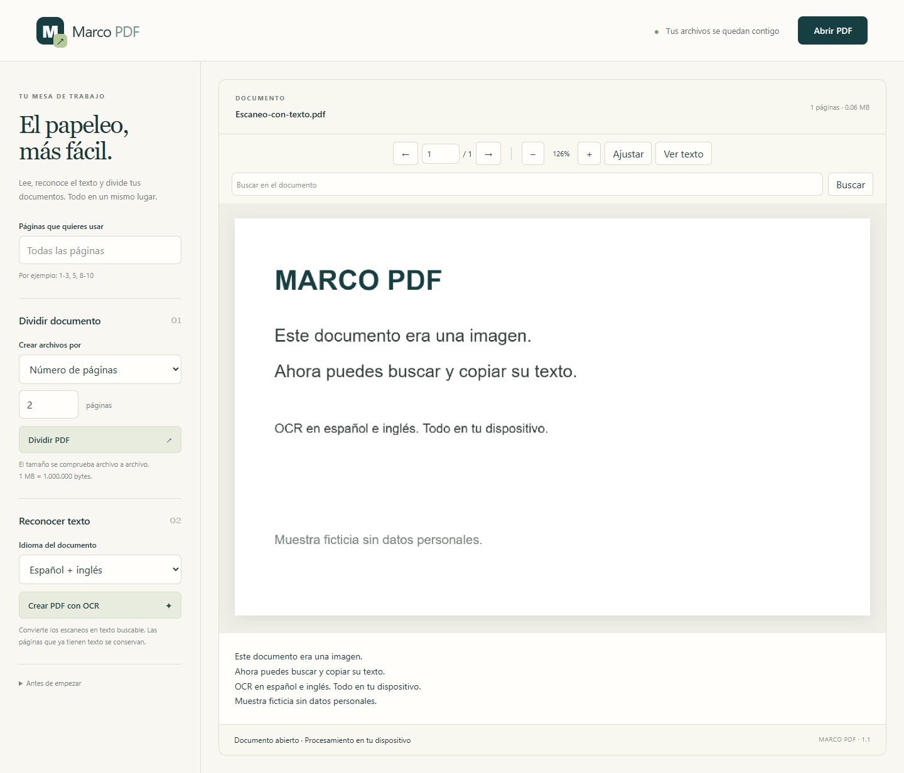

# Manual de uso

[Índice](README.md) · [Instalación](INSTALACION.md) · [Dudas frecuentes](PREGUNTAS.md)

## Abrir y leer

Pulsa **Abrir PDF**. En la web también puedes arrastrar un archivo. Las flechas cambian de página; el zoom y **Ajustar**/**Ajustar ancho** adaptan la vista. Web y Android permiten escribir el número de página. En escritorio, `Ctrl+O` abre el selector.

**Buscar**/**Buscar texto** recorre el texto disponible. Las búsquedas avanzan desde la página siguiente y vuelven al inicio al alcanzar el final. Escritorio resalta coincidencias; web muestra la página y su texto. **Ver texto** permite seleccionar y copiar el contenido.

Si un escaneo no contiene texto, crea primero una versión con OCR y ábrela. Los PDF protegidos con contraseña se abren en escritorio, donde se solicita la contraseña; web y Android no los desbloquean.

## Elegir las páginas

Se numeran desde **1**. Deja el campo vacío para usar todas.

| Entrada | Qué selecciona |
| --- | --- |
| `4` | Página 4 |
| `2-5` | Páginas 2, 3, 4 y 5 |
| `1-3,5,8-10` | Esos intervalos y la página 5 |
| `5,1-2` | Página 5 primero, después 1 y 2 |

No se admiten intervalos descendentes ni páginas fuera del documento. Las repetidas se incluyen una sola vez y se respeta el orden de la selección. La selección se aplica a división y OCR.

## Dividir por páginas

1. Selecciona las páginas que necesitas.
2. En escritorio, escribe una cantidad en **Dividir cada N páginas**. En web/Android, elige **Número de páginas** y escribe la cantidad.
3. Pulsa el botón para dividir.

Ejemplo: 10 páginas divididas cada 3 generan partes de **3 + 3 + 3 + 1** páginas. Para extraer `2-5` en un único archivo, selecciona `2-5` y divide cada 4 páginas.

En escritorio se crea una subcarpeta nueva con `parte_001.pdf`, `parte_002.pdf`, etc. En web aparecen botones para cada parte y **Guardar todo en ZIP**. Android usa el menú de compartir para exportar el PDF o el ZIP.

## Dividir por megas

1. Elige **Tamaño máximo (MB)** en web/Android, o el campo de MB en escritorio.
2. Introduce el máximo que debe ocupar cada archivo.
3. Divide y guarda los resultados.

**1 MB = 1.000.000 bytes.** Se mide el PDF serializado real, incluidos sus recursos. No se estima a partir del tamaño original. Las páginas permanecen completas y en el orden elegido.

Si una página individual supera el máximo, se detiene la división sin entregar una colección parcial. Aumenta el límite. Dividir no equivale a comprimir y los nuevos PDF pueden duplicar recursos entre partes.

## Crear un PDF con OCR

1. Abre el escaneo y selecciona páginas.
2. Elige **Español**, **Inglés** o **Español + inglés**.
3. Pulsa **Crear PDF con texto** en escritorio o **Crear PDF con OCR** en web/Android.
4. Guarda con otro nombre y abre el resultado para buscar o copiar texto.

Las páginas sin texto se renderizan a 200 ppp y reciben una capa reconocida. Las páginas con texto previo se copian sin OCR adicional. En web, los caracteres que no admite la fuente latina se sustituyen por `?`.

El OCR puede omitir títulos, confundir letras, alterar espacios o equivocarse con tablas, escritura manuscrita y escaneos torcidos. Revisa lo reconocido. Una página que mezcla texto digital e imágenes no recibe OCR adicional de esas imágenes.

## Guardado y diferencias

| Acción | Escritorio | Web/Android |
| --- | --- | --- |
| Partes | Nueva subcarpeta en la ubicación elegida | Botones de descarga/compartir |
| Todas las partes en ZIP | No incluido | Sí |
| OCR | Elegir nombre de un PDF nuevo | Guardar/compartir el resultado |
| PDF con contraseña | Introducir contraseña | Usar escritorio |
| Texto | Ventana independiente | Panel bajo el documento |

El original no se modifica. Los derivados no conservan las firmas digitales ni los marcadores originales. Los documentos grandes requieren memoria y tiempo: espera a que termine una operación antes de iniciar otra. No se editan párrafos ni se añaden firmas, anotaciones o formularios.
